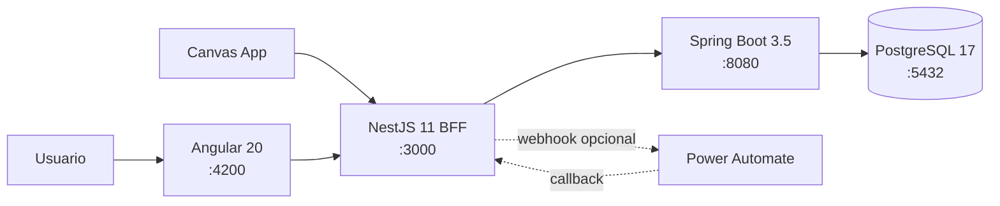

# Smart Approval Hub

MVP full stack para registrar y decidir solicitudes de compra. Resuelve un flujo empresarial frecuente y demuestra separación entre experiencia web, integración y dominio: Angular consume un BFF NestJS, que delega las reglas y persistencia a Spring Boot/PostgreSQL. Power Platform se integra mediante contratos abiertos, sin ser requisito para ejecutar localmente.

## Funcionalidades

- Alta con validación, detalle, listado, búsqueda y filtro por estado.
- Aprobación automática hasta **1.000.000 COP**; montos superiores quedan pendientes.
- Aprobación/rechazo manual, comentario obligatorio al rechazar y protección contra decisiones repetidas.
- Métricas de totales, estados y monto acumulado.
- Swagger, health checks, migraciones Flyway y cinco registros de demostración.
- Webhook opcional y no bloqueante para Power Automate.

## Arquitectura y tecnologías



NestJS desacopla clientes y orquesta integraciones; Spring Boot es la única fuente de reglas y transacciones. Esto evita duplicar dominio en el frontend o en Power Platform.

## Estructura

```text
frontend/          Angular standalone, rutas lazy y formularios reactivos
api-gateway/       NestJS BFF, Swagger, validación e integración
approval-service/  Spring Boot, JPA, Flyway y dominio
power-platform/    OpenAPI, guías Power Apps/Automate y JSON de ejemplo
docs/              Notas para entrevista
docker-compose.yml Orquestación local completa
```

## Inicio rápido con Docker

Requisitos: Docker Desktop con Compose. No se necesita Node, Java ni Maven instalados.

```bash
copy .env.example .env
docker compose up --build
```

En Linux/macOS usa `cp`. Espera a que los health checks estén saludables y abre http://localhost:4200. Para reiniciar conservando datos: `docker compose down`; para eliminar también la base local: `docker compose down -v`.

## Ejecución manual

Requisitos: PostgreSQL 17, Java 21/Maven 3.9+, Node 22+ y npm.

```bash
# Spring Boot (con variables DATABASE_URL, DATABASE_USER y DATABASE_PASSWORD)
cd approval-service
mvn spring-boot:run

# NestJS, otra terminal
cd api-gateway
npm install
npm run start:dev

# Angular, otra terminal
cd frontend
npm install
npm start
```

Las variables disponibles están en `.env.example`: credenciales locales de PostgreSQL, puertos, `PUBLIC_GATEWAY_URL`, timeout y webhook opcional. No guardes `.env` ni secretos en control de versiones. CORS queda limitado a los orígenes configurados.

Para puertos alternativos en PowerShell:

```powershell
$env:POSTGRES_PORT="5433"
$env:SPRING_PORT="8081"
$env:GATEWAY_PORT="3000"
$env:FRONTEND_PORT="4201"
$env:CORS_ORIGIN="http://localhost:4201"
docker compose up -d --build
```

Angular consume `/api` de forma relativa. Nginx lo reenvía a `api-gateway:3000` dentro de Docker; `ng serve` utiliza `frontend/proxy.conf.json` hacia `localhost:3000`. Así el navegador nunca necesita resolver nombres internos de Docker.

## URLs

| Recurso | URL |
|---|---|
| Aplicación | http://localhost:4200 |
| Simulador Power Apps | http://localhost:4200/power-apps-demo |
| Swagger UI | http://localhost:3000/docs |
| OpenAPI JSON | http://localhost:3000/docs-json |
| Health del gateway | http://localhost:3000/api/health |
| Health de dominio | http://localhost:8080/actuator/health |
| PostgreSQL | localhost:5432 |

## Pruebas

```bash
cd approval-service && mvn test
cd api-gateway && npm test && npm run build
cd frontend && npm test -- --browsers=ChromeHeadless && npm run build
docker compose config
npx swagger-cli validate power-platform/custom-connector.openapi.yaml
```

Con los servicios arriba, prueba el flujo real en PowerShell con `./docs/smoke-test.ps1`.

Para diagnosticar el frontend con Chrome headless y ejecutar el flujo de interfaz completo:

```bash
cd frontend
node scripts/diagnose-browser.mjs http://localhost:4201
node scripts/browser-flow.mjs http://localhost:4201
```

La demostración dedicada está en `/power-apps-demo`. Sus llamadas pasan por `/powerapps-api`, que Nginx reenvía a `/api/powerapps`. Si se define `POWER_APPS_DEMO_KEY`, Nginx añade el header sin incluir la clave en el bundle.

### Diagnóstico de la pantalla blanca

La versión inicial servía correctamente `index.html` y todos los bundles, pero Chrome registraba `NG0908` y dejaba `app-root` vacío. La causa era que `zone.js` estaba configurado únicamente para Karma, no para el build productivo. `frontend/angular.json` ahora incluye el polyfill en `build.options.polyfills`.

Al validar el dashboard después del arranque apareció un segundo error: el listado respondía 500 con PostgreSQL `lower(bytea) does not exist`. La consulta JPQL combinaba parámetros opcionales nulos con `lower/concat`. El repositorio ahora elige un método tipado según los filtros presentes y no envía parámetros nulos ambiguos.

## Power Platform

Importa [custom-connector.openapi.yaml](power-platform/custom-connector.openapi.yaml) y sigue [POWER_APPS_GUIDE.md](power-platform/POWER_APPS_GUIDE.md). Para el flujo de aprobación configura `POWER_AUTOMATE_WEBHOOK_URL` y sigue [POWER_AUTOMATE_GUIDE.md](power-platform/POWER_AUTOMATE_GUIDE.md). Canvas App, conector y flujo requieren crearse en el tenant Microsoft; la aplicación local funciona sin ellos y deja una simulación explícita en logs.

## Decisiones, seguridad y evolución

- UUID evita ids secuenciales expuestos; `BigDecimal` mantiene exactitud monetaria; `Instant` normaliza tiempo.
- DTOs se validan en ambos backends; Spring centraliza excepciones y el gateway traduce respuestas aguas arriba.
- Consultas parametrizadas por JPA tratan la búsqueda de forma segura; hay timeouts y logs sin cuerpos sensibles.
- El MVP omite autenticación deliberadamente. Producción usaría Microsoft Entra ID/OAuth2/OIDC, RBAC, secretos en vault, TLS, rate limiting, auditoría inmutable, paginación, observabilidad, idempotencia del callback, mensajería/outbox, backups y CI/CD con análisis de dependencias.
